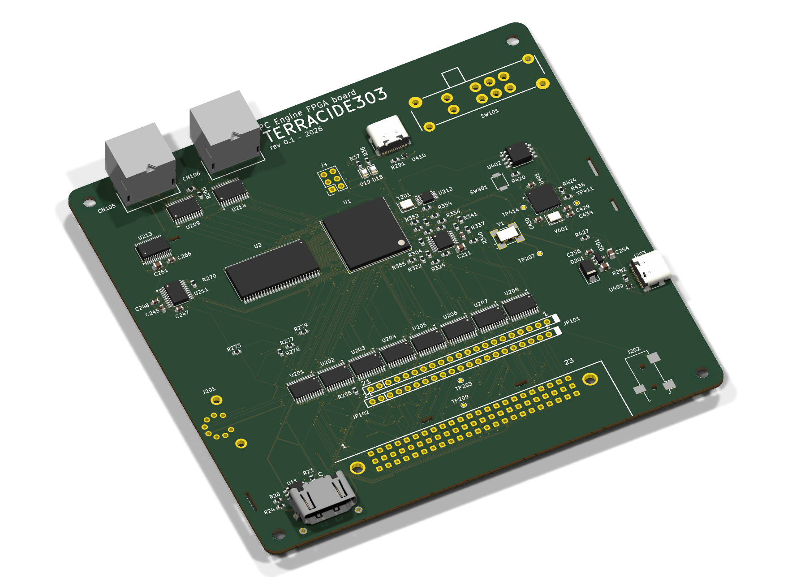
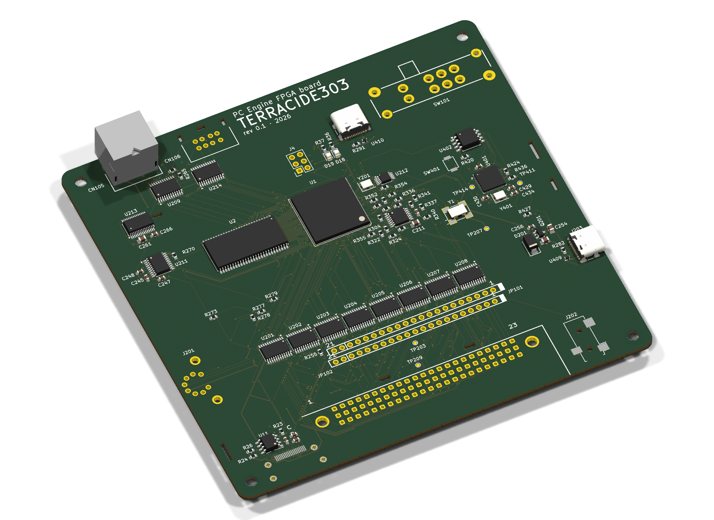
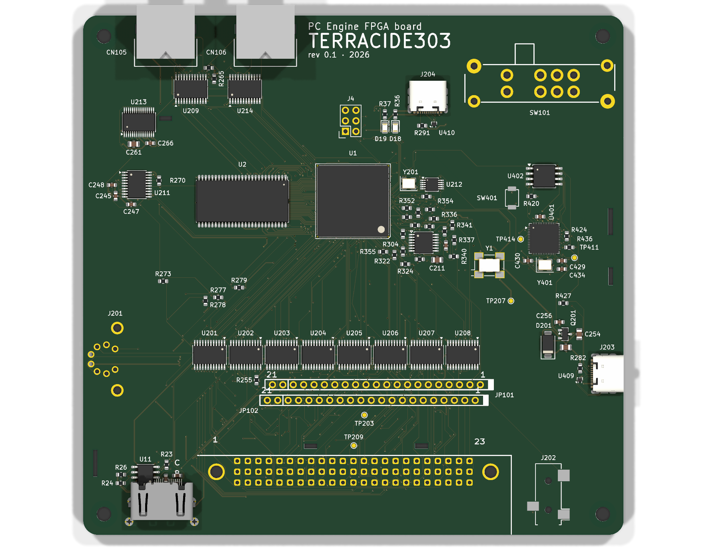
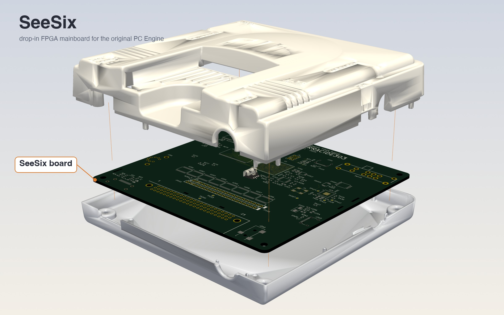

# SeeSix: a PC Engine FPGA board

**Codename SeeSix.** **SeeSix** is the drop-in version (what the docs and pictures call "Classic"). **SeeSix+** is the version with the extra parts fitted (what they call "Plus").

> **Work in progress.** Nothing has been built or tested yet. The FPGA core that runs
> on it is still in development.
>
> **The sources are private for now.** The hardware files, tools and documentation will be made public when the design has been tested and is ready.

A replacement mainboard for the original PC Engine (the small white 1987 console).
Same size, same mounting holes, and the HuCard slot, expansion port, controller port
and power switch sit exactly where they are on the original, so it drops into the
original case. An FPGA does the work of the original chips.

## On the board

- Lattice ECP5-85F FPGA (BG381), 32 MB SDRAM, config flash
- Si5351 clock chip for the exact PC Engine clock
- RP2040 for the menu, settings and USB
- HuCard slot and expansion port, both fully wired, with 5 V level shifters
- RGB and composite video, PCM5102A stereo audio
- USB-C power, in place of the old power jack; the original power switch still works
- 4 layers

## Two versions, one board

Both are the same PCB. SeeSix (Classic) leaves the extra connectors off; SeeSix+ (Plus) fits them.

**Classic** fits an original case without cutting it. Video and stereo sound come out of
a DIN-8 socket in the hole where the RF jack was, and the expansion port works as on the
original, so an AV booster style adapter still works too.

**Plus** is for a new or modified case. It adds HDMI on one side of the expansion port, a
3.5 mm line out on the other side, and a second controller port on the front. Two USB-A
ports for USB pads are planned on the front as well, but are not on the board yet.

| | SeeSix (Classic) | SeeSix+ (Plus) |
|---|---|---|
| case | original, unmodified | new or modified |
| video | RGB + composite on the DIN-8 | same, plus HDMI |
| audio | DIN-8 and the expansion port | plus 3.5 mm line out |
| controllers | one original port | two original ports (USB-A planned) |

What you see in the pictures, from the front edge (top of the top view) to the back:

- front: controller port(s), and the power switch on the right
- middle: the FPGA with the SDRAM to its left, the RP2040 on the right, and the row of
  level shifters in front of the HuCard slot
- back: the expansion port, with HDMI and the line out either side of it (Plus)
- left side: the DIN-8, where the RF jack was; right side: USB-C power, where the power
  jack was
- the DIN sockets, HuCard slot, expansion port, power switch and line-out jack are drawn
  by us from their footprints (no vendor 3D models); the real parts differ in detail

## The case

SeeSix is made to drop into the original PC Engine case. It is also possible to 3D print a complete new shell, and a customised shell that makes the new PCB fit is coming soon.

*The shell in the picture is a third-party 3D model; its credit will be added.*

## Status

| part | state |
|---|---|
| schematic | done, checked |
| PCB | work in progress |
| FPGA core | in development |
| case openings | listed in the private docs |

More detail comes with the sources, which are private for now.

## Based on

- [ULX3S](https://github.com/emard/ulx3s) by EMARD / Radiona (FER): the FPGA, memory and
  power section is based on it.
- [Board-Folk PC-Engine](https://github.com/Board-Folk/PC-Engine): board outline, holes and
  connector positions of the original.
- SeeDee², the HuCard CD-ROM²
  card, which shares the RP2040 and audio circuits.

Copied files keep their own licences; they will be listed with the sources.

## Community and support

- **Discord:** join the PC Engine FPGA community: https://discord.gg/zsYdGqHXS
- **Ko-fi:** this is an open project I build in my spare time. If it helps you, a coffee on [Ko-fi](https://ko-fi.com/terracide) helps me keep going.
